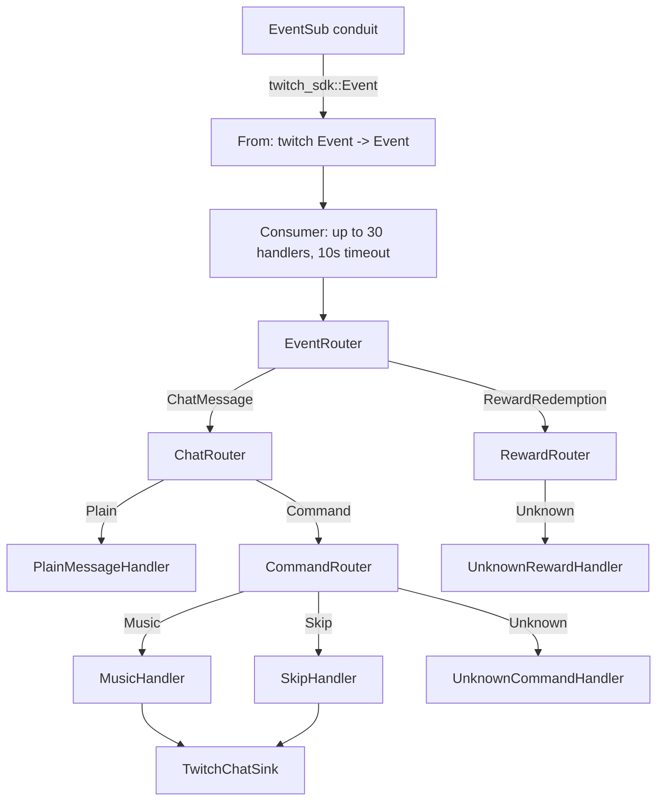

# Twitch Bot

Twitch bot workspace in Rust with a small staged event pipeline:

- Twitch EventSub is the input source
- incoming SDK events are mapped into domain `Event`
- `Event` is parsed into typed requests (`ChatRequest`, `CommandRequest`, `RewardRequest`) and dispatched statically with exhaustive `match`
- routers dispatch by stage
- handlers execute bot behavior

The current executable lives in `crates/twitch-bot`. The workspace also contains a small Twitch SDK.

## Current behavior

What the bot actually does today:

- consumes Twitch EventSub events through `twitch-sdk`
- supports two domain event kinds in the main pipeline:
  - chat messages
  - channel point reward redemptions
- routes chat messages into:
  - plain messages
  - commands
- supports two registered commands:
  - `!music`
  - `!skip`
- logs and ignores unknown commands
- logs redemptions of rewards unknown to the bot
- logs plain chat messages at `trace`

Command behavior:

- `!music` calls `playerctl metadata` and sends `сейчас играет трек <artist> - <title>` to chat, or `сейчас ничего не играет` when no player is running
- `!skip` calls `playerctl next` and sends `переключил трек` to chat

## Workspace layout

```text
crates/
├── twitch-bot/     # application crate
└── twitch-sdk/     # Twitch auth, Helix and EventSub SDK
```

Important application modules:

```text
crates/twitch-bot/src/
├── adapters/       # Twitch + system integrations
├── app/
│   ├── command.rs  # chat command parsing
│   ├── dispatch/   # handler trait, routers, typed requests
│   ├── handlers/   # leaf handlers
│   └── ports/      # application-facing interfaces
├── config/         # YAML config loading, parsed into non-empty values
├── model/          # domain events, roles, tracks
├── runtime/        # consumer, logging, signals, run_until_shutdown
├── bootstrap.rs    # composition root
└── main.rs         # process entrypoint
```

## Architecture

The current codebase is not organized as `core/domain/infra` directories anymore. It is organized around the runtime pipeline and application stages.

High-level flow:

```text
main
  -> LogGuard::init
  -> bootstrap::run
  -> ConfigFile::from_env().load
  -> ClientCredentials app access token (in memory, requested on start) + HelixClient
  -> routers + handlers wiring
  -> start_events(EventSub) -> (Stream<Item = Event>, EventSubHandle)
  -> runtime::run_until_shutdown(events, Consumer, eventsub.shutdown())
```



### Runtime details

The runtime behavior currently implemented in code:

- `Consumer` processes up to `30` events concurrently
- each event handler execution has a `10s` timeout
- graceful shutdown waits up to `15s`
- shutdown is triggered by `SIGINT`, `SIGTERM`, or `SIGHUP`
- logging is initialized through `tracing` before anything else; default filter is `twitch_bot=debug,twitch_sdk=info` and can be overridden with `RUST_LOG`
- EventSub uses a conduit managed with the app access token: on start the bot reuses its one-shard conduit (or creates one) and subscribes to it (an existing subscription, `409`, is fine); every WebSocket session is attached to shard `0` right after welcome
- EventSub reconnects after `5s` on any disconnect; on `session_reconnect` it follows `reconnect_url` and re-attaches the shard without re-subscribing
- malformed EventSub messages are logged and skipped instead of dropping the connection; duplicate notifications are dropped by `message_id`; a revoked subscription drops the connection and is re-created on reconnect
- chat sends check the HTTP status and Helix `is_sent`; on `401` the cached token is invalidated and the send is retried once

### Static dispatch

Every stage is a closed algebraic type, and every router is an exhaustive `match` over it:

- `Event` → `ChatMessage | RewardRedemption`
- `ChatRequest` → `Plain | Command`
- `Command` → `Music | Skip | Unknown(name)`
- `Reward` → `Unknown(id)`

Routers are generic over concrete handler types (`EventRouter<C, R>`, `CommandRouter<M, S, U>`, …), so the whole tree is built at compile time and there is no runtime registration or `dyn` dispatch. `Handler` is a native async trait.

The domain is honest about what it does not know: unknown commands and rewards are explicit `Unknown` variants, not a hidden fallback.

Chat text is parsed, not validated: `Command: FromStr` either produces a `Command` or the message is a plain message. A command name must follow `!` immediately (`! music` is plain text).

### Adding a command

1. add a variant to `Command` and its name to `Command::from_str`
2. add a handler field to `CommandRouter` and a `match` arm
3. pass the handler in `bootstrap.rs`

The compiler points at every place that must change.

### Adding a reward

Reward IDs are generated by Twitch when a reward is created in the channel dashboard. Add a variant to `Reward`, map its ID in `From<&str> for Reward`, then extend `RewardRouter` the same way. A recreated reward gets a new ID and falls into `Reward::Unknown`.

## Event model

The application-level domain event enum mirrors the EventSub subscriptions the bot creates:

- `Event::ChatMessage`
- `Event::RewardRedemption`

`twitch_sdk::event::Event` is exhaustive, so the mapper in `adapters/twitch/mapper.rs` has no fallback branch: a new SDK event does not compile until the bot decides what to do with it.

## twitch-sdk

Layers depend in one direction: `eventsub → helix → auth`.

```text
crates/twitch-sdk/src/
├── auth/
│   ├── error.rs         TokenError
│   ├── token.rs         AccessToken
│   └── source.rs        TokenSource { Static, ClientCredentials }: app access token in memory, re-requested before expiry or after 401; TokenEvent for the consumer to log
├── helix/
│   ├── client.rs        HTTP transport: GET/POST/PATCH, headers, retry once on 401, response → TryFrom
│   ├── error.rs         ApiError: token, request, status, rate limit, decode
│   ├── chat.rs          send_chat_message → SendMessageError { Api, Dropped(DropReason) }
│   └── eventsub.rs      conduits, create_single_shard_conduit, assign_websocket_shard (ConduitError), subscribe
├── eventsub/
│   ├── subscription.rs  Subscription enum → type, version, condition
│   ├── wire.rs          Twitch JSON → Frame and public events
│   ├── session.rs       one WebSocket connection: welcome, keepalive, notification, reconnect, revocation
│   ├── error.rs         EventSubError (internal: handled by the reconnect loop)
│   ├── dedup.rs         recent message ids
│   └── client.rs        conduit + shard attachment, EventSub::spawn → (Receiver<Event>, EventSubHandle)
├── event.rs             public events
└── reconnect.rs         retry delay and cancellation
```

Adding a subscription touches `Subscription`, `wire` and `event`; exhaustive `match` in each makes it impossible to miss one.

Every public operation returns only the errors it can produce: `TokenSource::access_token` → `TokenError`, `send_chat_message` → `SendMessageError`. Lower-level errors are wrapped with `#[from]`, so `?` converts them. EventSub errors never leave the crate: the reconnect loop logs them and reconnects.

## Configuration

The bot reads `./config.yaml`, or the path in the `TWITCH_BOT_CONFIG` environment variable:

```yaml
twitch:
  auth:
    broadcaster_id: "..."
    client_id: "..."
    client_secret: "..."
    writer_id: "..."
```

Every field is parsed into `NonEmptyString` via `#[serde(try_from = "String")]`, so an empty value fails at load time. `client_secret` is a `ClientSecret` whose `Debug` prints `***`.

No user tokens are stored anywhere: the bot requests an app access token (Client Credentials) on every start and keeps it in memory.

### One-time authorization

An app access token can read and send chat only after the account has authorized the app once. Open this URL logged in as the bot/broadcaster account (the redirect URI must be registered for the app in the Twitch developer console) and approve:

```text
https://id.twitch.tv/oauth2/authorize?response_type=token&client_id=<CLIENT_ID>&redirect_uri=<REDIRECT_URI>&scope=user%3Abot+user%3Aread%3Achat+user%3Awrite%3Achat+channel%3Abot+channel%3Aread%3Aredemptions&force_verify=true
```

The token in the redirect can be ignored: Twitch remembers the authorization, and that is all the bot needs.

## Running

Requirements:

- recent stable Rust with Edition 2024 support
- `playerctl` installed and available in `PATH`
- Unix-like OS
- Twitch app credentials (`client_id`, `client_secret`) and the one-time authorization above

Setup:

```bash
cp example.config.yaml config.yaml
```

Run:

```bash
cargo run -p twitch-bot
```

Release build:

```bash
cargo run -p twitch-bot --release
```

## Development

Check the workspace:

```bash
cargo check
```

Run tests:

```bash
cargo test
```

Format:

```bash
cargo fmt
cargo fmt --check
```

Lint:

```bash
cargo clippy --workspace --all-targets
```


## Current limitations

These limitations are real in the current code:

- commands have no role checks or cooldowns yet; `ChatMessage::author_role` (an ordered `Role`) is ready for that middleware
- no rewards are known to the bot yet, every redemption is `Reward::Unknown`
- the app is Unix-oriented because it depends on `tokio::signal::unix` and `playerctl`

## License

MIT
